# Signal / Noise — UI redesign: implementation and verification

Branch `claude/signal-noise-redesign`, 21 October 2026. This note records what the redesign
changed, which defects it fixed, how it was checked and what was not checked. Screenshots, the
motion reel and the raw QA/performance output are in [`docs/redesign/`](redesign/).

## Provenance

| | |
|---|---|
| Source | `Signal-Noise-main.zip` (SHA-256 `0d38dc3b…a760c`) plus the repair handoff. GitHub `quasi-causal-drafts/Signal-Noise` was not reachable from this session; the work lives in `ixcxyy/upgraded-carnival`. Upstream commit SHA: unknown. |
| `9148701` | The upload as received (reconstructed by reverse-applying the handoff patch to the repaired tree; the result is byte-identical to the handoff tree minus the patch). |
| `0b3bb1a` | The handoff repairs, applied unchanged (`git apply`), then compared with `diff -r` against the handoff's repaired tree: identical. |
| `e9b1a8e` | Shared primitives (tokens, icons, motion, tooltip, dialogs, build order). |
| `0631fa9` | Story surfaces. |
| `aaa3aa6` | Workbench, analyser, debugger, results; two defect fixes with tests; QA harness. |
| later | Native select styling, QA/perf tools, this note. |

No story content, emulator, checker, SDK or Rust code was changed. The story hash is unchanged
(`513dbc85`), so existing saves load as before. New settings (`theme`, `motion`, `panel`) and bench
layout fields (`filesOpen`, `sideOpen`, `bottomOpen`, `focus`) are optional with defaults.

## What changed

**Foundation (`app/ui/src/shared/`, built as `ui.js`, `window.SN`).** The story is classic
shared-scope scripts and the bench is bundled modules, so the primitives are their own bundle,
loaded first: `ui.js → api.js → bench.js → story.js` (see `shell.html`). Both halves call
`window.SN` at call time, so one tooltip, one dialog stack and one icon set serve the whole app.

- `tokens.css` — OLED-black ground `#050506`, graphite panels `#111215`/`#191C20`, off-white
  `#F4F4F2`, pale cyan/silver accent; semantic colours for ok/warn/fault/breakpoint/program
  counter/signals; radii, spacing, depth and motion tokens; glass/opaline only on contextual
  surfaces (dock, tooltip, popover, dialogs, banner). A light "Daylight" theme and "System" follow
  the same tokens.
- Type: Geist (OFL) for interface text, IBM Plex Mono for code and values, Literata kept for the
  narrative voice, Architects Daughter kept for Elias's notebook. Barlow Condensed and the blanket
  uppercase-condensed styling are gone.
- Icons: Lucide 1.61 (ISC, `node_modules/lucide/LICENSE`), one stroke weight; a square-wave glyph
  and the brand mark are drawn on the same grid. Every icon-only control has an accessible name, a
  tooltip and, where one exists, its shortcut (`aria-keyshortcuts` + capsule).
- Motion (`motion.js`): Web Animations with retargeting (a new animation on the same key starts
  from the current visual state), a sampled spring as CSS `linear()` with a cubic fallback, FLIP
  and a title "morph". Durations 120 / 200 / 320 / 420 ms. Reduced motion (system setting or the
  in-game option) applies end states without animating and stops decorative loops.
- Dialogs replace every `window.prompt/confirm` (file new/rename/delete, breakpoint condition,
  variable/register writes, new/delete profile, new game, chapter replay) and the quit-failure
  `alert`. They trap focus, close on Escape, restore focus, and keep a backend refusal inline so
  the player can correct and retry. Game shortcuts are suspended while any overlay is up.

**Story.** Title with brand mark and a pointer-reactive reflective wordmark; the J4.7 strip is
labelled *decorative* and on its first showing resolves from noise into the pulse in ~620 ms while
the buttons are already live; returning to the title skips the reveal; hidden windows stop
drawing; reduced motion draws one still frame. One dominant Begin/Continue; profiles, settings and
quit are icon controls; author tools moved into a folded section of the menu. Reading column with
distinct narration/dialogue/SMS/letter/message/notebook treatments, a glass command dock with
numbered choices and "Skip to next choice", task cards with status chips. The notebook rail
(Work/Case/Codex) has a moving indicator and a label for the active destination; picking the open
destination folds the panel. Clue popover: an opaline card that grows from the chosen phrase and
retracts into it, with a pointer-following sheen; the engine's visibility rules are untouched
(an open whisper gets no hover tint, underline or animation — checked in QA). Work orders keep
required behaviour and acceptance always visible, add a pin map drawn from the level's own pin
records next to the original schematic text, and fold secondary sections. Case board counts and
groupings still come only from `engine.board()`.

**Workbench.** Header with task identity, an icon-led command dock (Build/Run/Debug/Submit) whose
indicator follows the running action or the next sensible step (Submit never requires a passing
Run), and a one-line status readout. Debugging swaps the dock in place for an instrument cluster:
Continue/Pause share a slot, step over/into/out, a visually distinct reverse step, restart, stop,
and the backend's time. Files, editor tabs (dirty / saving / failed states), analysis strip and
inspector rail restyled; panels fold to rails and remember the player's explicit choice; the
analysis area starts folded until something has been built, run or debugged. `Ctrl+J` toggles it,
`Ctrl+Shift+E` focuses the editor; splitters take arrow keys; saved sizes are clamped to the
window. CodeMirror's theme sits in a compartment (`dark` follows the page) and is reconfigured in
place — documents, history and breakpoints are never recreated. The task title flies from the
story card into the bench header; the story's scroll position is restored on return.

**Analyser, debugger, results.** Channel swatches and restrained per-channel colours, rounded
cursor handles, A/B/Δ capsules with frequency, icon zoom/fit/edge controls, hatched mismatch
regions under a dashed expected lane, a compact empty state with a Run button. Evidence opens
with a short bloom over the region; a reverse step leaves a fading band between the two real
backend times and sweeps the program-counter line backwards. No data coordinate, timestamp or
level is ever eased. Results lead with the verdict, a chip per seed from the backend's list, the
first broken rule with "Show on the waveform" and "Replay seed", faults with "Go to file:line".
Debugger sections, state chips (Stopped/Running/Faulted/Ended) and change marks computed from the
previous stop's own formatted values.

## Defects fixed in this pass

| Defect | Cause | Fix | Evidence |
|---|---|---|---|
| Deleting a file while its autosave chain was in flight could write the newer text back after the delete. | `deleteFile` awaited only the write in flight; `saveFile` then chained the next revision. | `removeFile` marks the path as deleting, waits for the whole chain, and `saveFile` never writes a path being deleted. | `tools/tests/ui-regressions.test.cjs`: "an autosave chain in flight cannot recreate a file…" (fails on the previous code, passes now). |
| Starting the debugger kept the previous run's expected lane and cursor A over the live trace (seen in the baseline screenshot `before-debug`). | Evidence and cursors belong to a recording; the live trace reused the view. | Debug start clears evidence and cursors; a new recording without `keepView` starts without cursors. | Test "starting the debugger drops evidence and cursors…" (fails before, passes now); QA screenshot `after-debug`. |
| After the redesign's focus return, Space on a re-focused phrase would reopen the clue instead of continuing. Found by the QA script before commit. | Focus returned to the phrase after any close. | Focus returns to the phrase only when the card was opened from the keyboard; a pointer-opened card releases focus. | QA check "popover: Escape, then Space continues reading". |
| WebKitGTK drew the seed and profile `<select>` as light GTK combo boxes. | Native appearance. | `appearance: none` with a token-coloured chevron. | Native captures `native-run-before-select-fix` and `native-run` / `native-menu` (rebuilt `.deb`, Xvfb). |

The handoff repairs (serialized writes, failed-save retention, stale-read guards, profile isolation,
story-save ordering, quit safety, board sizes, hidden-seed wording) are unchanged and their 23
tests still pass.

## Screen and action map

Graphify was not available; this is the state table the redesign was built against.

| Screen | Reached from | Main actions (shortcut) | Leaves to |
|---|---|---|---|
| Title | boot, brand mark, menu, ending | Begin/Continue, New game (confirm), Profiles/Settings, Quit (desktop) | Story, Menu |
| Story | Title | Continue (Space/Enter), choose (1–9), Skip to next choice, click/Enter a detail | Clue popover, Rail panels, Bench, Menu, Title |
| Clue popover | a live detail | Ask (scene), Note it, Let it go, Close (Esc) | Story (focus returns when opened by keyboard) |
| Rail: Work order / Case board / Codex | rail or narrow tab bar | pick ticket, open bench, read document, codex sub-tabs | Story, Bench |
| Bench | dock, ticket, stub card | Build (Ctrl+B), Run (Ctrl+Enter), Debug (F5), Submit (Ctrl+Shift+Enter), seed, own check, file ops, Ctrl+J, Ctrl+Shift+E | Story (back), Debug mode |
| Debug mode | Debug | Continue (F5), Pause (F6), over/into/out (F10/F11/Shift+F11), back (Shift+F10), restart (Ctrl+Shift+F5), stop (Shift+F5), travel to cursor, instruction step | Bench |
| Results | Run/Submit | seed chips, Show on the waveform, Replay seed, Go to source | Waveform |
| Menu sheet | menu icon, profile chip, title | profile switch/new/delete, theme, text size, motion, casual clues, replay chapter, save file, author tools | Title, ledger/files/save pages |

## Verification

| Check | Result | Evidence |
|---|---|---|
| `node tools/ledger-cli.js content/story` | pass — 0 errors, 0 warnings, 6 notes; 450/450 playthroughs reach the ending; 99/99 scenes; deterministic | run on the final tree |
| `cargo test --release --workspace` | pass — 22 tests across 14 test binaries | run on the final tree (Rust unchanged) |
| `cargo build --release` | pass | |
| `./target/release/k28 ci` | pass — "ALL GOOD", every reference passes, every anti-solution fails for its reason, traces identical with idle-skipping on/off | the bundled zig 0.13 was fetched with `toolchain/fetch-zig.py` |
| `npm ci` / `npm run build` / `npm run test:ui` (in `app`) | pass — 25/25 (23 handoff + 2 new) | |
| Browser QA against the real dev server (`tools/qa/capture.cjs`) | pass — 26/26 checks, 0 page errors | `docs/redesign/qa-report.json`; real compiler, emulator and checkers |
| Handoff mocked smoke (`tools/qa/mocked-smoke.cjs`, unchanged logic) | pass — failed close keeps the buffer, retry saves, profile switch A→B on the same task path reloads B, focus read keeps newer typing, datasheet search | mocked backend by design |
| Performance (`tools/qa/perf.cjs`) | recorded — see below | `docs/redesign/perf.json` |
| Linux bundle `npx tauri build --bundles deb` | pass — `Signal Noise_0.1.0_amd64.deb`, 60.8 MB (built before the version was raised to 0.2.0) | after installing the documented Tauri prerequisites |
| Native run (installed `.deb`, WebKitGTK 2.52.6, Xvfb 1440×900) | pass — title, story, bench, a real Run, debugger with reverse step rendered and worked | `docs/redesign/native-*.webp`; driven with xdotool |
| Windows installer | **not run** — needs a Windows runner | CI workflow unchanged |
| Native window close/quit flush | **not run** natively — covered by the handoff's mocked close-handler test only | no window manager under Xvfb |
| Layouts | checked at 1440×900, 1000×620 (native minimum), 1920×1080 and 720 px (narrow browser): no horizontal overflow | QA checks and screenshots |
| Reduced motion | checked — title strip static, no running animations on title, popover or idle bench | `perf.json` (`reduce` run) |

Performance, headless Chromium on this container (software rendering; machine-dependent, a
record rather than a promise). Frame intervals were vsync-capped at 16.7 ms throughout and no
frame exceeded 25 ms in the motion-on run; main-thread time from Chrome's own metrics:

| Scenario (motion on) | Wall | Main thread |
|---|---|---|
| Title, decorative loop, 3 s | 3.0 s | 233 ms (≈ 7.7 %); 40 ms with reduced motion |
| Clue popover grow | 0.65 s | 67 ms |
| Waveform: 60 wheel zooms after a real run | 3.0 s | 150 ms |
| Waveform: drag pan | 1.35 s | 152 ms |
| Bench idle | 2.0 s | 26 ms, 0 running animations |

Backdrop blur is limited to small contextual surfaces; no full-screen blur or shader runs
continuously.

## Screenshots and motion

Before → after (1440×900 unless noted):

| Before | After |
|---|---|
| 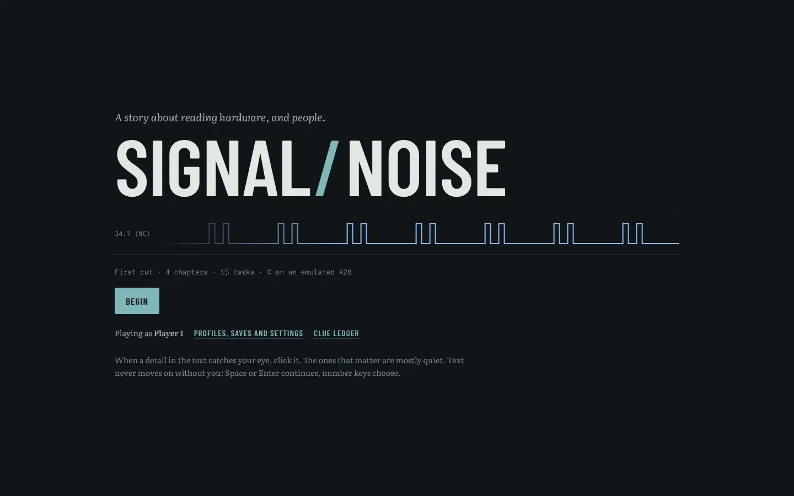 | 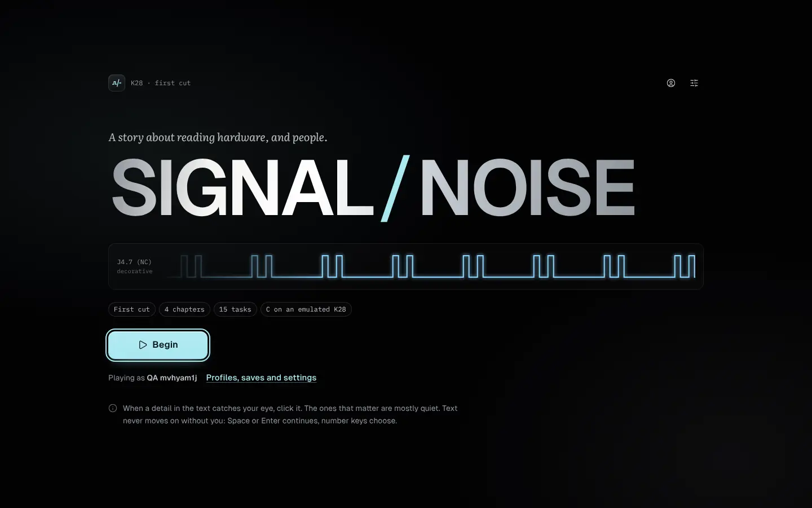 |
| 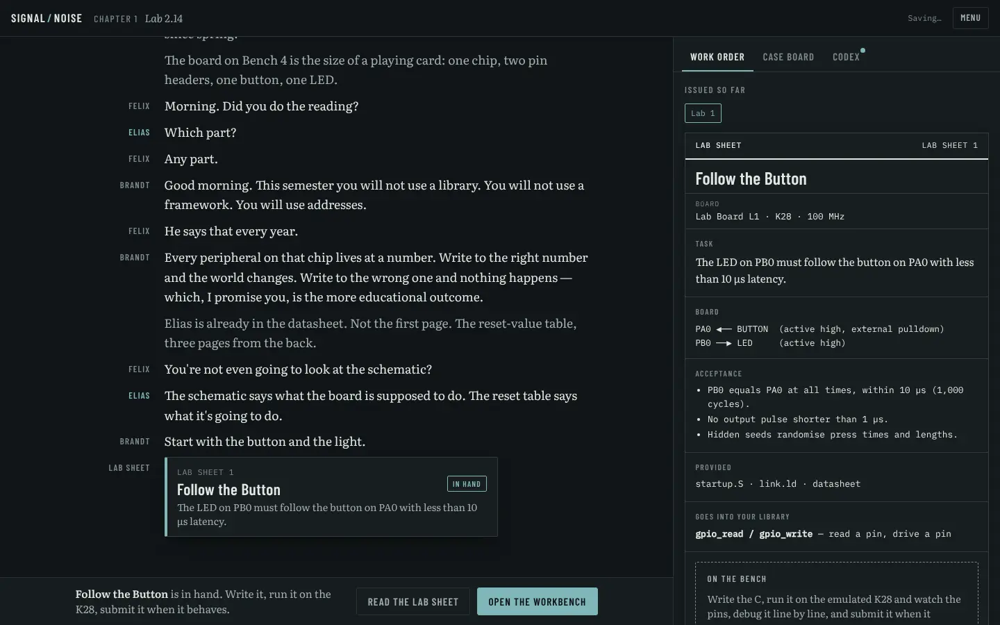 | 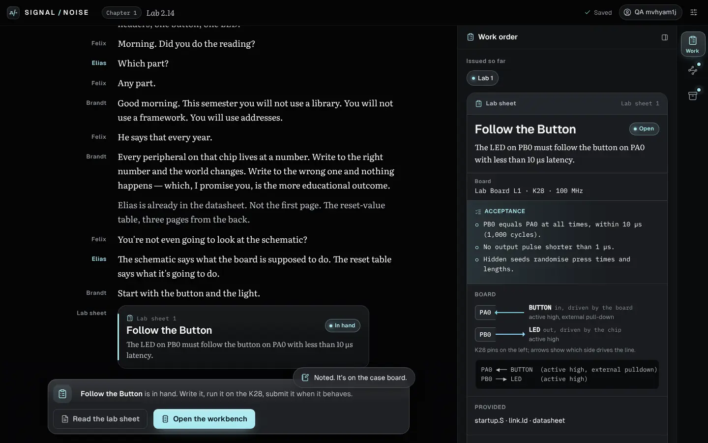 |
| 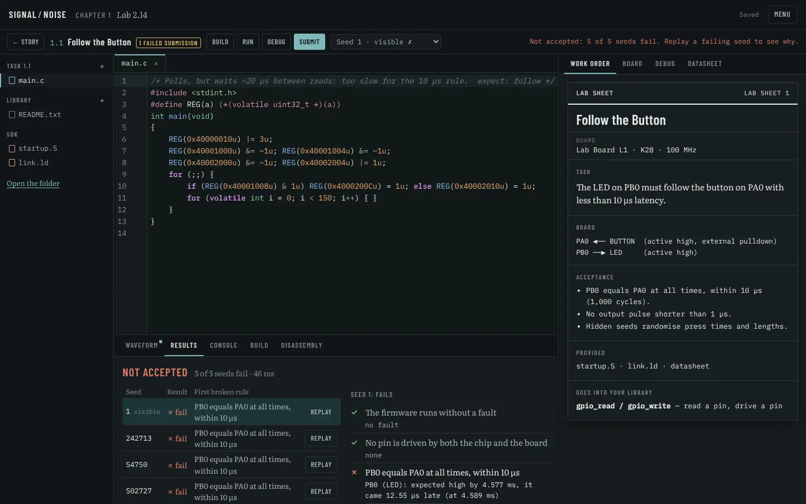 | 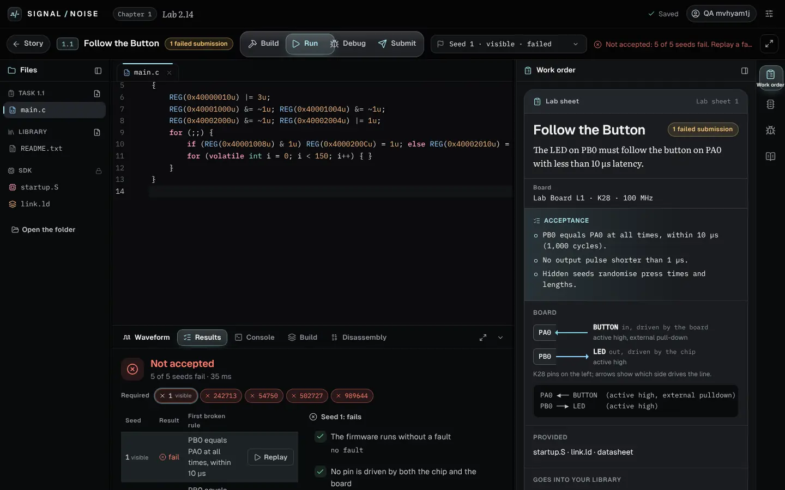 |
| 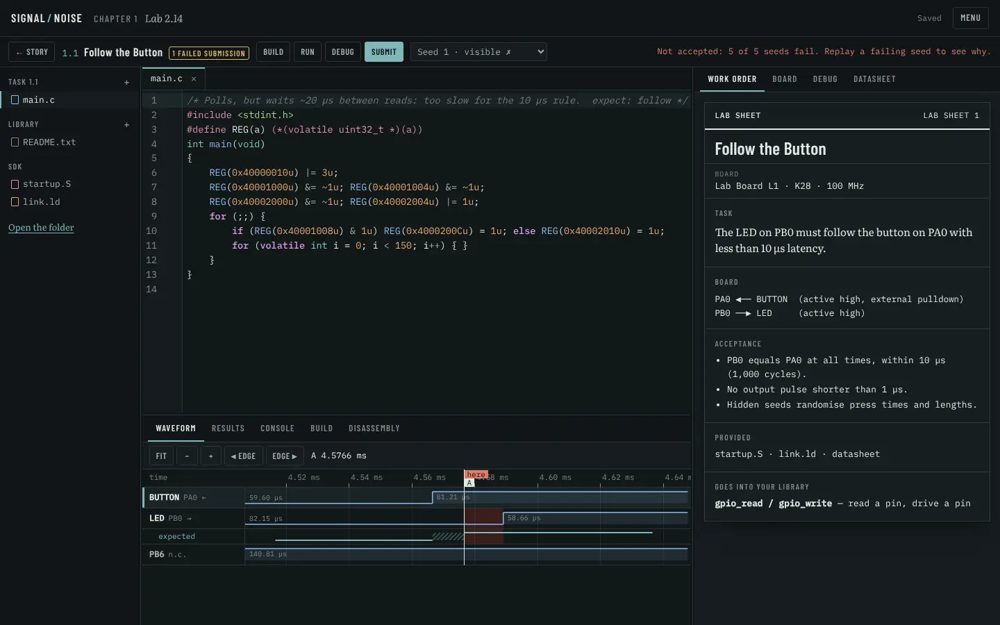 | 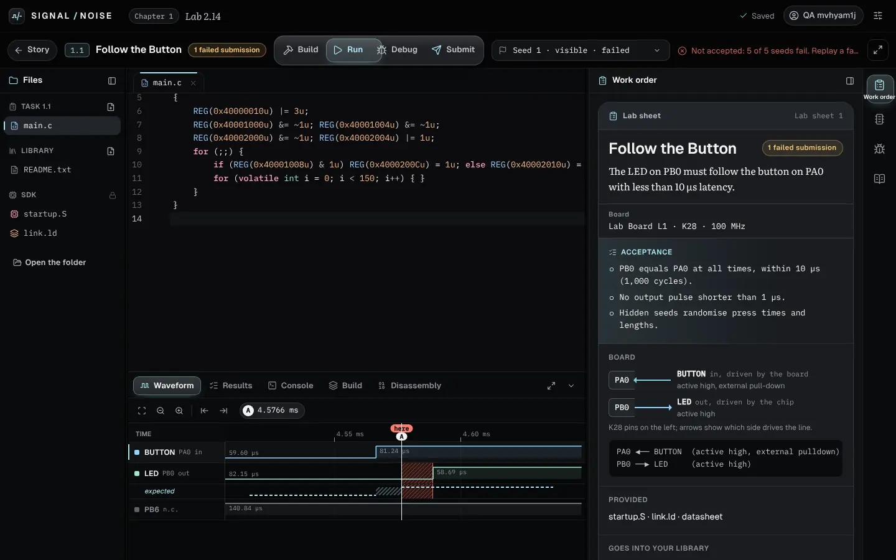 |
| 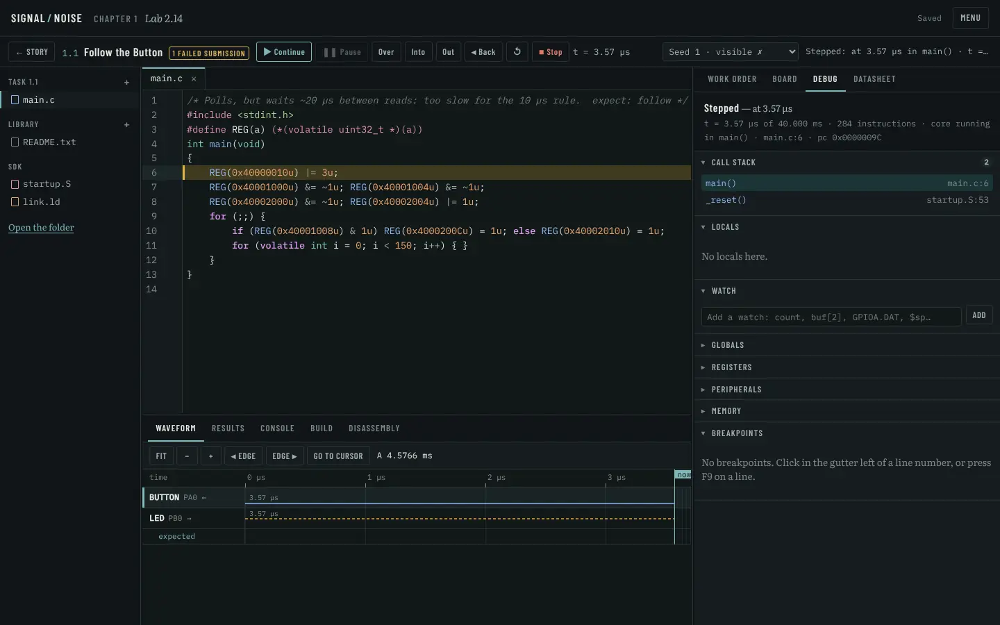 | 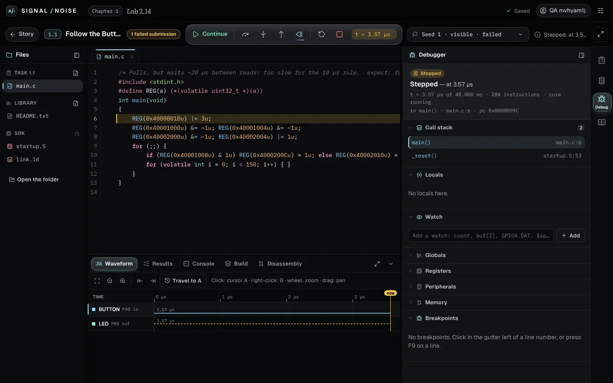 |
| 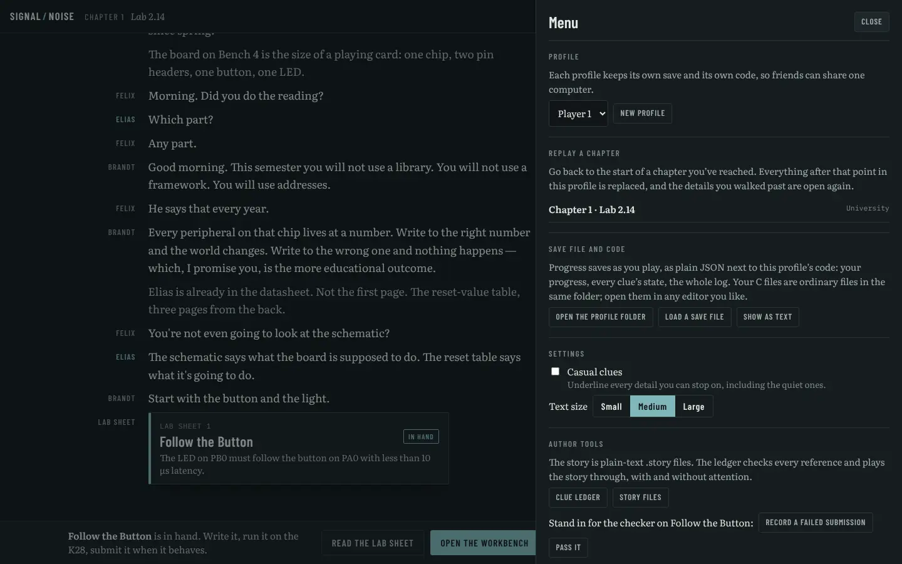 | 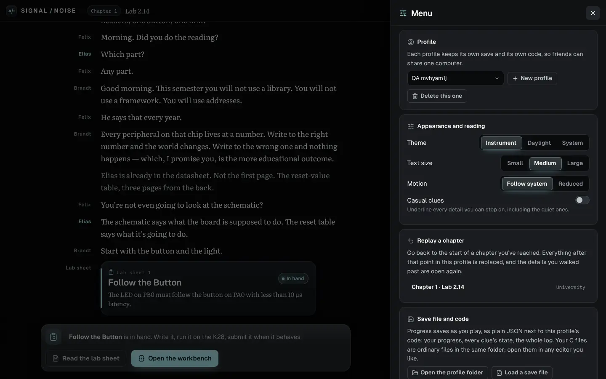 |
| 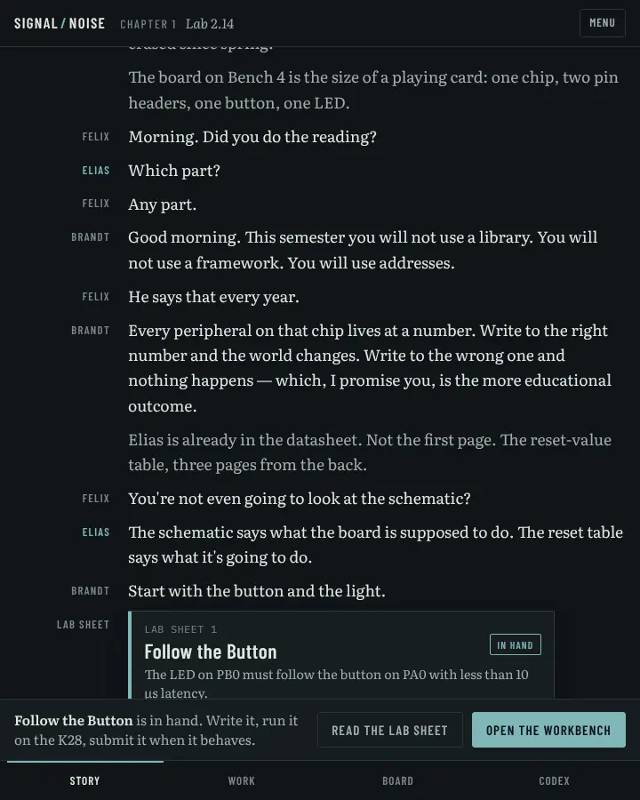 | 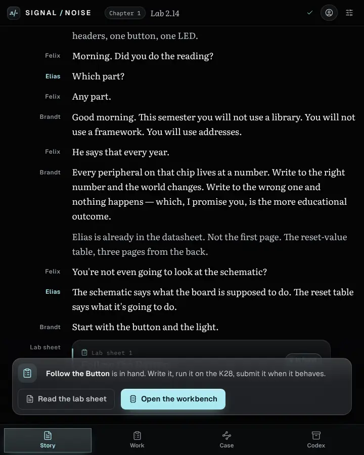 |

More: `after-title-reveal` (250 ms into the reveal), `after-popover`, `after-case-board`,
`after-codex`, `after-panel-folded`, `after-dialog`, `after-bench`, `after-build-error`,
`after-run`, `after-datasheet`, `after-focus`, `after-1000x620`, `after-1920x1080`, `after-light`,
and the native WebKitGTK captures `native-title`, `native-story`, `native-run`, `native-menu`, `native-debug` (taken before the select fix; its seed box still shows the GTK style) and `native-run-before-select-fix`.

[`redesign/motion-reel.webm`](redesign/motion-reel.webm) (26 s, recorded from the real app): title
reveal and sheen, rail indicator and tooltips, task card to bench, dock tooltips, a failed submit,
evidence moving onto the waveform, the dock swapping to the debugger, two steps and a reverse
step, focus mode, and the way back to the story.

## Running it

```sh
python3 toolchain/fetch-zig.py --platform linux-x86_64 --out app/src-tauri/resources/zig
cargo build --release
cd app && npm ci && npm run build && npm run test:ui && cd ..
./target/release/k28-devserver --port 8028 --ui app/dist --data /tmp/sn --res app/src-tauri/resources
# browser QA (Playwright outside the product):
NODE_PATH=$(npm root -g) node tools/qa/capture.cjs /tmp/sn-shots
NODE_PATH=$(npm root -g) node tools/qa/perf.cjs /tmp/sn-perf
NODE_PATH=$(npm root -g) node tools/qa/motion-reel.cjs /tmp/sn-reel
```

## Limits

- The Windows installer and native window-close behaviour were not exercised.
- Native checks ran under Xvfb without a window manager or GPU (software rendering).
- Phone-width firmware editing is not a goal: below 900 px the story uses its tab bar and the
  bench folds its file list, but the bench is designed for windows of 1000 px and up.
- Performance figures come from headless Chromium in a container, not from the target machines.
